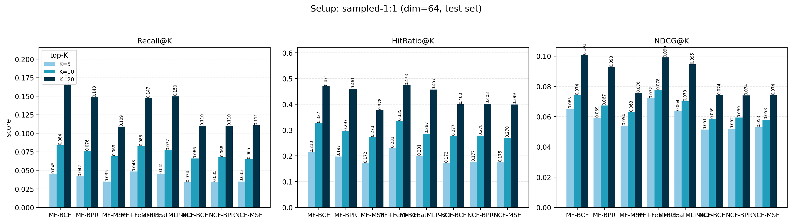
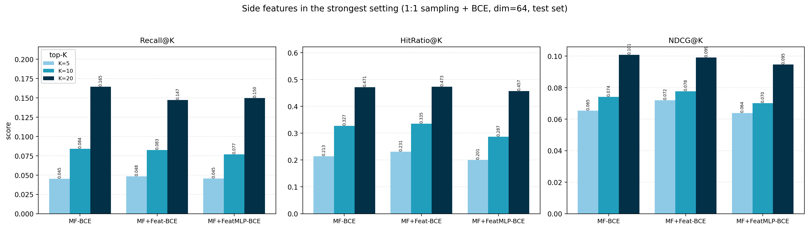
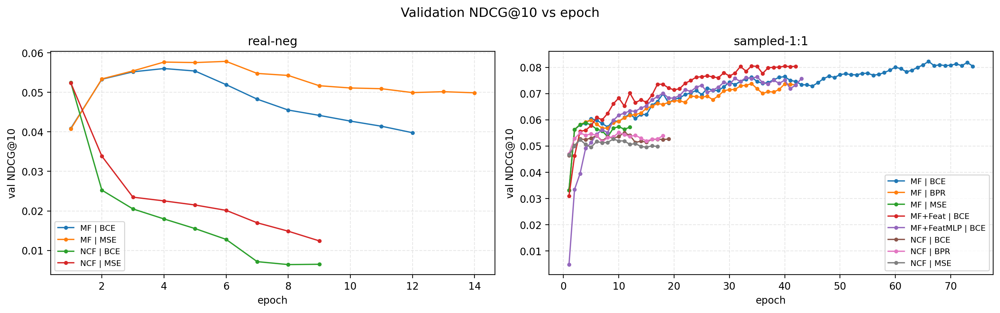

# MovieLens-100K 推荐实验：MF vs NCF，损失函数 / 负采样 / 侧特征对比

在 MovieLens-100K 上从零实现 **简易 MF** 与 **NCF（仅 MLP 分支）**，在**完全一致的超参数**下系统对比两种负样本构造方式、三种损失函数，并进一步在最强设置上验证**用户侧特征 + 电影侧特征**的增益。全部指标为全量排序下的 `Recall@K` / `HitRatio@K` / `NDCG@K`。

- 纯 PyTorch 实现，CPU 可跑，全部 12 组实验约 15 分钟
- 所有结果、日志指标、图表均随仓库提供，可直接查看 `results/`
- 固定随机种子，一条命令复现

---

## 快速开始

```bash
pip install -r requirements.txt

# 方式一：直接用仓库中已有的结果重新汇总 + 重绘图表（秒级）
python run_experiments.py --aggregate-only

# 方式二：完整复现 12 组实验（CPU 约 15 分钟，已存在的结果会自动跳过，需重跑加 --overwrite）
python run_experiments.py --overwrite

# 只跑某个子集
python run_experiments.py --setups sampled --models MF --losses BCE BPR
python run_experiments.py --runs MF+Feat__sampled__BCE --overwrite

# 冒烟测试（3 个 epoch，写入独立目录，不影响正式结果）
python run_experiments.py --max-epochs 3 --out-dir results_smoke
```

环境：Python 3.8+，`torch>=2.0`（CPU 即可）、`numpy`、`pandas`、`matplotlib`。已验证版本：Python 3.8 / torch 2.4.1+cpu / numpy 1.24.3 / pandas 2.0.3 / matplotlib 3.7.1。

---

## 目录结构

```
.
├── ml-100k/                  # MovieLens-100K 原始数据（实验只读取 u.data / u.user / u.item / u.genre）
├── recsys/
│   ├── config.py             # 超参数、实验网格定义
│   ├── data.py               # 读取、按时间 8:1:1 划分、正负样本、1:1 负采样
│   ├── features.py           # 用户 / 电影侧特征构建
│   ├── losses.py             # MSE / BCE / BPR
│   ├── models.py             # MF、NCF(MLP)、MF+Feat、MF+FeatMLP
│   ├── evaluate.py           # 全量排序评估 Recall@K / HitRatio@K / NDCG@K
│   ├── train.py              # 两套训练管线 + 验证集早停
│   ├── aggregate.py          # 结果汇总成表（含一致性校验）
│   ├── plots.py              # 可视化
│   └── utils.py
├── run_experiments.py        # 入口脚本
├── results/                  # 结果（raw json / csv / 图表）
├── requirements.txt
└── README.md
```

---

## 数据与划分

`ml-100k/u.data`：943 用户 × 1682 物品的 100,000 条评分（`用户ID | 物品ID | 评分 | 时间戳`），每个用户至少 20 条。

**标签规则**：`评分 > 3` → 真实正样本；`评分 < 3` → 真实负样本；`评分 == 3`（27,145 条）→ 中性，剔除。

**划分方式**：对每个用户按其评分时间戳先后做 **8:1:1** 切分（基于完整评分序列，不做预过滤），然后在每段内部再转成正/负样本。

划分后统计（`results/dataset_stats.json`）：

| 项目 | 数量 |
|---|---|
| 训练集交互 | 58,252（正 45,602 / 负 12,650，正负比 ≈ 3.6 : 1） |
| 验证集正样本 | 4,618（846 个用户） |
| 测试集正样本 | 5,155（862 个用户） |

**侧特征**（来自 `u.user` / `u.item`，`results/feature_spec.json`）：

| 来源 | 特征 | 维度 |
|---|---|---|
| `u.user` | 年龄(z-score)、性别、职业 one-hot(21 类) | 23 |
| `u.item` | 19 个类型 one-hot、上映年份(z-score)、年份缺失标记 | 21 |

zip code、片名、IMDb 链接、录像带发行日期未使用；标准化只用特征表自身统计量，不涉及评分或划分信息。

---

## 模型（隐向量维度统一为 64）

| 名称 | 打分函数 | 说明 |
|---|---|---|
| `MF` | `score(u,i) = <p_u, q_i>` | 简易矩阵分解 |
| `NCF` | `score = MLP([p_u, q_i])`，128→64→32→16→1，ReLU | NeuMF 去掉 GMF 分支，仅 MLP |
| `MF+Feat` | `u_vec = p_u + W_u f_u`，`i_vec = q_i + W_i f_i`，`score = <u_vec, i_vec>` | 侧特征投影进隐空间，参与点积交互 |
| `MF+FeatMLP` | `score = <p_u, q_i> + MLP([f_u, f_i])`，44→64→32→1 | 侧特征作为加性旁路（对照） |

## 训练方式与损失

| 训练方式 | 训练样本 | 损失 | 说明 |
|---|---|---|---|
| `real`（真实负样本） | 训练集全部 58,252 条真实正/负交互，正负比 3.6:1 | MSE、BCE | 有多少真实正负样本就用多少 |
| `sampled`（1:1 随机负采样） | 每个正样本配 1 个随机负样本（每 epoch 重采样，共 91,204 条） | MSE、BCE、BPR | 负采样池 = 全部物品 − 该用户**训练集**正样本 |

两点实现细节：

1. **负采样池不排除验证/测试集正样本**。若把验证/测试正样本从池中剔除，等于用未来标签参与训练构造，属数据泄露；因此池只基于训练集信息构建，采样出的负样本可能与该用户未来的正样本重合（有意保留的标签噪声）。
2. **MSE 作用在 `sigmoid(score)` 上**，与 0/1 标签做均方误差；BCE 使用 logits；BPR 为 pairwise `-log σ(s_pos − s_neg)`。

## 评估协议

- 对每个用户对全部 1,682 个物品打分并排序，**屏蔽**该用户训练集正样本（评估测试集时再屏蔽验证集正样本），避免推荐已交互物品。
- ground truth 为验证 / 测试集中的正样本；无测试正样本的用户不参与评估（实际 862 个用户）。
- 指标定义（`rel` 为该用户正样本集合，`topK` 为推荐列表）：
  - `Recall@K = |topK ∩ rel| / |rel|`
  - `HitRatio@K = 1[|topK ∩ rel| > 0]`，对用户取平均
  - `NDCG@K = DCG@K / IDCG@K`，`IDCG@K` 用 `min(|rel|, K)` 个理想位置计算
- 参考：随机排序基线 `Recall@10 ≈ 0.0057`、`HitRatio@10 ≈ 0.0429`、`NDCG@10 ≈ 0.0059`。

---

## 实验结果（测试集，K = 5 / 10 / 20）

### 训练方式 1：真实负样本

| 模型 | 损失 | 最优 epoch | Recall@5 | Recall@10 | Recall@20 | HR@10 | NDCG@5 | NDCG@10 | NDCG@20 |
|---|---|---|---|---|---|---|---|---|---|
| MF | **MSE** | 6 | 0.0366 | **0.0601** | **0.1007** | **0.2726** | 0.0533 | **0.0576** | **0.0713** |
| MF | BCE | 4 | 0.0325 | 0.0566 | 0.0942 | 0.2459 | 0.0521 | 0.0558 | 0.0686 |
| NCF | MSE | 1 | 0.0310 | 0.0536 | 0.0950 | 0.2587 | 0.0485 | 0.0527 | 0.0664 |
| NCF | BCE | 1 | 0.0310 | 0.0533 | 0.0943 | 0.2599 | 0.0486 | 0.0524 | 0.0662 |

### 训练方式 2：1:1 随机负采样

| 模型 | 损失 | 最优 epoch | Recall@5 | Recall@10 | Recall@20 | HR@10 | NDCG@5 | NDCG@10 | NDCG@20 |
|---|---|---|---|---|---|---|---|---|---|
| **MF+Feat** | **BCE** | 34 | **0.0485** | 0.0825 | 0.1473 | **0.3353** | **0.0720** | **0.0777** | 0.0991 |
| MF | BCE | 66 | 0.0453 | **0.0839** | **0.1645** | 0.3271 | 0.0653 | 0.0741 | **0.1008** |
| MF+FeatMLP | BCE | 35 | 0.0454 | 0.0770 | 0.1499 | 0.2865 | 0.0638 | 0.0702 | 0.0946 |
| MF | BPR | 34 | 0.0419 | 0.0762 | 0.1483 | 0.2970 | 0.0593 | 0.0674 | 0.0927 |
| MF | MSE | 4 | 0.0350 | 0.0691 | 0.1089 | 0.2726 | 0.0541 | 0.0630 | 0.0758 |
| NCF | BPR | 10 | 0.0346 | 0.0678 | 0.1102 | 0.2784 | 0.0520 | 0.0595 | 0.0740 |
| NCF | BCE | 11 | 0.0338 | 0.0659 | 0.1104 | 0.2773 | 0.0514 | 0.0585 | 0.0744 |
| NCF | MSE | 9 | 0.0350 | 0.0651 | 0.1107 | 0.2703 | 0.0529 | 0.0580 | 0.0742 |

完整数值（含验证集、所有指标）见 `results/results_test.csv`、`results/results_val.csv`。

### 可视化

| 图 | 内容 |
|---|---|
| `results/figures/metrics_by_setup_real.png` | 真实负样本：MSE vs BCE / MF vs NCF |
| `results/figures/metrics_by_setup_sampled.png` | 1:1 采样：MSE vs BCE vs BPR |
| `results/figures/feature_ablation_best_setting.png` | 最强设置下的侧特征消融 |
| `results/figures/all_runs_ndcg_at10.png` | 全部 12 组按 NDCG@10 排名 |
| `results/figures/metrics_vs_k.png` | 各指标随 K 的变化 |
| `results/figures/heatmap_ndcg.png` / `heatmap_recall.png` | 12 组 × K 热力图 |
| `results/figures/val_ndcg_curves.png` | 验证集 NDCG@10 训练曲线（真实负样本下 NCF 的过拟合可见） |
| `results/figures/train_loss_curves.png` | 训练损失曲线 |







---

## 主要结论

1. **1:1 随机负采样明显优于使用全部真实负样本**：最佳 NDCG@10 `0.0777` vs `0.0576`（+35%）。真实负样本正负比 3.6:1 且分布偏置，模型容易学到"样本先验"而非排序偏好。
2. **真实负样本设置下 NCF 严重过拟合**：训练损失持续下降，验证 NDCG@10 从 `0.052` 跌至 `0.007`（接近随机），最优 epoch 落在第 1 轮；MF 可稳定训练到第 6 轮。该设置下 MF 优于 NCF，且 MSE 略优于 BCE。
3. **1:1 采样下 BPR 是 NCF 的最佳损失**（NDCG@10 `0.0595` > BCE `0.0585` > MSE `0.0580`），但 MF 侧 BPR 不及 BCE（`0.0674` vs `0.0741`）。
4. **侧特征有效，但注入方式很关键**：投影进隐空间（`MF+Feat`）使 NDCG@5 `+10.2%`、NDCG@10 `+4.8%`、HR@10 `+2.5%`，并把收敛轮数从 66 降到 34；而加性旁路（`MF+FeatMLP`）反而全面变差（NDCG@10 `−5.3%`、HR@10 `−12.4%`），说明特征需要参与 (u, i) 交互而非仅提供标量偏移。
5. **头部精度与长尾覆盖存在取舍**：`MF+Feat` 在 K=5/10 上领先，但 Recall@20 下降 10.5%（`0.1645` → `0.1473`）；追求覆盖面时 `MF__sampled__BCE` 更均衡。

---

## 复现细节

| 项目 | 值 |
|---|---|
| 隐向量维度 | 64（所有模型一致） |
| 优化器 | Adam，lr = 1e-3，weight_decay = 0 |
| batch size | 1024 |
| 最大 epoch | 100 |
| 早停 | 监控验证集 NDCG@10，patience = 8，回滚到最优 epoch 权重 |
| 随机种子 | 2024（Python / NumPy / PyTorch 均固定） |
| NCF 隐层 | concat(64+64) → 64 → 32 → 16 → 1 |
| MF+Feat 投影 | `Linear(23, 64)`、`Linear(21, 64)` |
| MF+FeatMLP 隐层 | concat(23+21) → 64 → 32 → 1 |
| 评估 | 每 epoch 全量排序评估验证集，测试集只评估最优 epoch |

所有实验共享同一份 `TrainConfig`（`recsys/config.py`），只有模型结构与损失不同，保证对比公平。实验网格定义在 `config.SETUPS` 与 `config.MODEL_ALLOWED` 中。

## 结果文件说明

| 路径 | 内容 |
|---|---|
| `results/raw/<run_id>.json` | 单组完整记录：每 epoch 训练损失 / 验证指标、最优 epoch、验证与测试指标、耗时、超参数、负采样池规则、侧特征说明 |
| `results/results_test.csv` / `results_val.csv` | 宽表：一组一行，含全部指标 |
| `results/results_long.csv` | 长表：`run_id × split × K` 一行 |
| `results/results_summary.json` | 三种表的 JSON 版本 |
| `results/dataset_stats.json` | 划分统计、标签规则、侧特征维度 |
| `results/feature_spec.json` | 侧特征字段名与维度（由代码生成） |

`run_id` 命名规则：`模型__训练方式__损失`，例如 `MF+Feat__sampled__BCE`。

## 已知限制

- **单一随机种子**（2024）单次运行，指标差在 2%–5% 量级时不宜过度解读；如需显著性结论应做多种子重复。
- **早停敏感性**：真实负样本设置下 NCF 的指标完全依赖早停（最优 epoch = 1），若改变 patience 或 epoch 上限结论会变。
- **采样负样本可能命中未来正样本**：这是为规避数据泄露而有意接受的标签噪声（见"训练方式与损失"第 1 点）。
- **评估覆盖**：943 个用户中有 81 个用户的测试段不含正样本（中性评分被剔除），实际评估 862 个用户。
- **汇总校验**：`recsys/aggregate.py` 会校验 `results/raw/*.json` 的文件名、`run_id` 与 `model/setup/loss` 字段是否自洽，不自洽的文件会告警并跳过，避免污染表格与图表。

## 数据来源与参考

- 数据集：[MovieLens 100K](https://grouplens.org/datasets/movielens/100k/)，GroupLens Research，版权归其所有，仅用于学习与研究。
- Harper & Konstan, *The MovieLens Datasets: History and Context*, ACM TiiS, 2015.
- He et al., *Neural Collaborative Filtering*, WWW 2017.（NCF / MLP 分支）
- Rendle et al., *BPR: Bayesian Personalized Ranking from Implicit Feedback*, UAI 2009.

## 许可

仓库代码可自由用于学习与研究。当前未附带正式的 `LICENSE` 文件；如需以开源方式发布，建议补充 MIT 或 Apache-2.0 许可证并注明版权归属。数据集版权归 GroupLens 所有。
